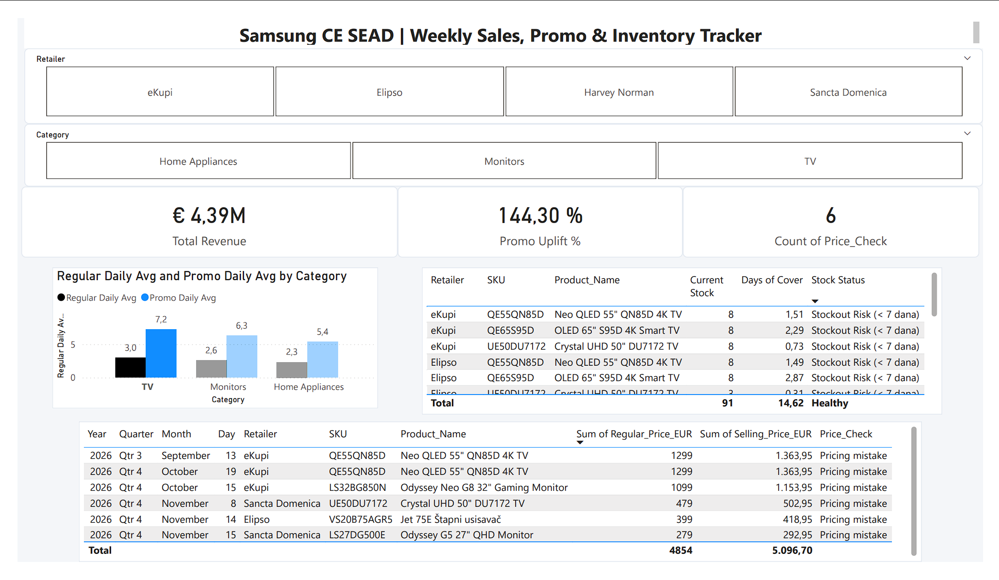

# Consumer Electronics Retail & Promotion Analysis

Interactive Power BI dashboard and data analysis project focused on retail sales performance, promotional price validation, and shelf inventory monitoring across four consumer electronics retailers (*Sancta Domenica, Elipso, Harvey Norman, eKupi*).

## What This Project Covers
* **Data Hygiene & Audit (Power Query):** Enforced unique daily keys (`Date + Retailer + SKU`) to remove duplicates and isolated promotional pricing errors into a separate `Promo_Audit` exception table.
* **Promotional Uplift (DAX):** Built dynamic measures comparing regular vs. promotional daily sales, showing a **+130% to +140%** sales uplift during active campaigns.
* **Inventory Risk Tracking:** Calculated `Days of Cover` to flag fast-moving **Stockout Risks** (under 7 days of stock left) and slow-moving **Dead Inventory** (30+ days without movement).

## Repository Files
* `samsung_ce_dashboard.pbix` — Interactive Power BI report (Power Query + DAX measures + visuals).
* `powerbi_dashboard.png` — Preview screenshot of the final dashboard.
* `ce_retail_raw.csv` & `ce_retail_clean.csv` — Raw and cleaned 90-day retail sales and stock datasets.
* `retail_analysis.py` & `chart_promo_uplift.png` — Python script (`pandas`, `matplotlib`) used to generate the dataset and verify KPIs.
